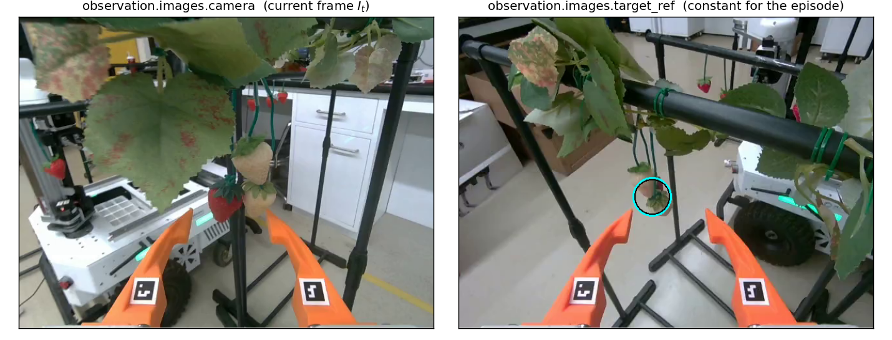
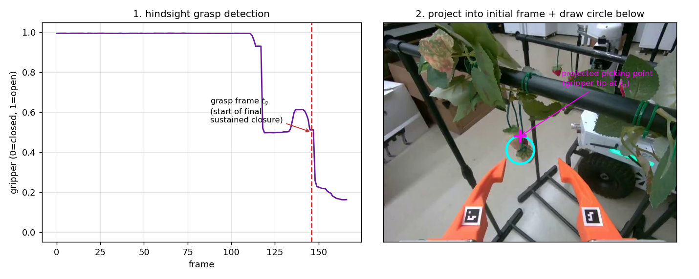
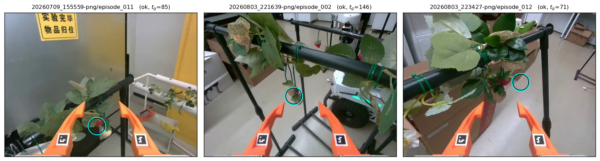
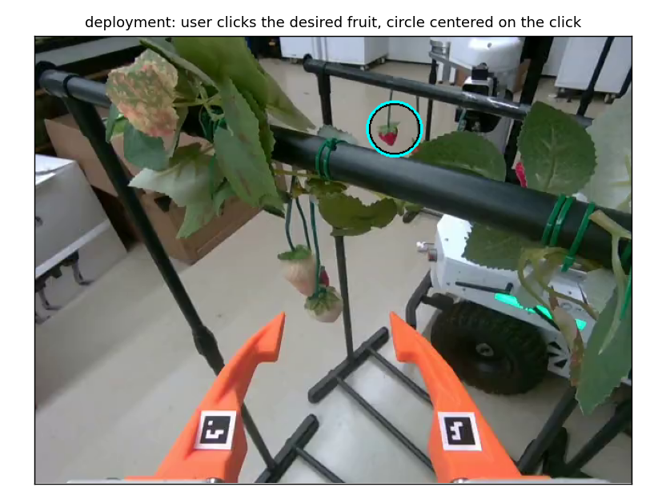

# Target-Conditioned Strawberry Picking (`observation.images.target_ref`)

A minimal target-conditioning scheme for the UMI/SROI → LeRobot pipeline. The policy
receives, in addition to the current camera frame, a **constant** reference image: the
episode's initial frame with a circle drawn around the strawberry it is supposed to pick.

$$
\pi\bigl(a_{t:t+H} \mid I_t,\ G\bigr), \qquad G = \texttt{target\_ref}
$$

This solves the multi-strawberry ambiguity: without a target signal, a policy trained on
scenes with several visible fruit has no way to know which one is intended and may
hesitate between them or pick an arbitrary one.

## Conditioning interface

| feature | content |
|---|---|
| `observation.images.camera` | current frame $I_t$ (unchanged) |
| `observation.images.target_ref` | **constant** marked initial frame $I_0$ |
| `action` | unchanged (7-dim EE pose + gripper) |

`target_ref` is just a second image input — ACT encodes it with the shared ResNet backbone
and concatenates its tokens with the camera tokens; π0.5 embeds it like any other camera.
**No policy-code changes are required**: any `observation.images.*` video feature in the
dataset automatically becomes a visual input (`dataset_to_policy_features`). Keep
`consecutive_frames=1` (the default) so the static reference is not frame-stacked.



*Left: the current camera frame changes every step. Right: `target_ref` is frozen at the
initial frame for the whole episode, with the target strawberry circled.*

## Hindsight labeling (no perception modules)

The target is derived **purely geometrically** from the demonstration — no detection,
segmentation, SAM, or tracking anywhere (`target_ref.py`):

1. **Grasp frame $t_g$** — the start of the *final sustained gripper closure*
   (gripper convention 0 = closed / 1 = open; NaN tails from tag occlusion are filled,
   5-frame moving average, ≥ 0.5 s hold). Using the start of the final closure — rather
   than the last frame — means the post-grasp pull-away does not shift the label.
2. **Projection into the initial image** — the gripper-tip pose at $t_g$ is expressed in
   the initial camera frame using the VO trajectory and the camera↔gripper-tip extrinsics
   (the same math as `visualization/visualize_traj_video.py`):

$$
   {}^{C_0}T_{G_{t_g}} = ({}^{W}T_{C_0})^{-1}\ {}^{W}T_{C_{t_g}}\ {}^{C}T_{G},
   \qquad u = f_x \frac{x}{z} + c_x,\quad v = f_y \frac{y}{z} + c_y
$$

3. **Marker** — a rough cyan circle (default radius 30 px at 480p, resolution-scaled) drawn
   **below** the projected picking point so its body covers the fruit hanging underneath.
   It labels *which object*, not *where exactly to grasp* — the picking location itself is
   learned by the policy from the demonstrations.



## QC / rejection

Episodes are skipped (and logged with their status in `meta/target_qc.csv`) when:

| status | meaning |
|---|---|
| `no_sustained_closure` | no closed-gripper segment ≥ the hold time |
| `closure_at_start` | gripper already closed at frame 0 → no pick event observed |
| `depth_invalid` | projected depth z ≤ 0 (behind camera) or z > 1.5 m (unstable VO) |
| `out_of_frame` | projected point outside the initial image |
| `no_trajectory` / `no_intrinsics` | missing trajectory / camera info |

Per-episode details (grasp frame, pixel, depth, marker parameters) are stored in
`meta/target_ref/<episode>.json`. Inspect labels before training:

```bash
python visualization/visualize_target_ref.py /path/to/data --recursive --num-samples 24 -o /tmp/target_qc.pdf
```



*Random QC samples: the circle lands on the actually-picked strawberry in each episode.*

## Usage

### Conversion (opt-in; the default pipeline is unchanged)

```bash
python lerobot/sroi_to_lerobot.py \
    --data_path /path/to/session-or-parent \
    --repo_id sroi/lab_picking_targeted --fps 30 \
    --root /mnt/data1/sroi/lerobot/lab_picking_targeted \
    --task "pick the marked strawberry" \
    --target-conditioning
```

Useful knobs: `--marker-style circle|bbox|point`, `--marker-radius-px`,
`--marker-offset-px`, `--closed-threshold`, `--grasp-hold-seconds`, `--extrinsics-config`.

### Example dataset

A ready example built from the 20260803 occlusion sessions (199 candidate episodes):
`/mnt/data1/sroi/lerobot/sroiv2_strawberry_picking_lab_20260803_target_ref_example`
— **144 episodes / 17 652 frames**, 54 rejected by QC (27 `no_sustained_closure`,
23 `out_of_frame`, 4 `closure_at_start`).

### Deployment semantics

1. Capture the initial image.
2. User clicks the desired strawberry.
3. Render the **same** marker (circle centered on the click, offset 0):

```bash
python lerobot/render_target_ref.py --image init.png --u 320 --v 240 -o target_ref.png
```

4. Freeze the marked image and feed it with every observation for the whole episode.



### Test

```bash
/home/zfei/anaconda3/envs/py312/bin/python lerobot/test_target_conditioning_e2e.py \
    --episode-dir /path/to/a/real/episode_002
```

Converts a synthetic episode (known grasp frame) plus optionally a real one, and asserts:
feature exists, constant across the episode, detected $t_g$ and projected $(u,v)$ match,
marker visible at the expected ring, and the default mode (flag off) is unaffected.

## Training-data requirement

The conditioning only works if the data contains **meaningful target variation**: in
scenes with multiple strawberries, record otherwise-similar demonstrations that pick
*different* fruit. Otherwise the network can ignore `target_ref` and learn a positional
bias (always-leftmost, always-closest). Single-strawberry demonstrations remain usable.

## Evaluation protocol

Keep the existing picking metric and add, bucketed by visible-strawberry count
(1 / 2 / 3 / 4+):

- **intended-target pick success** — the marked fruit was picked
- **any-strawberry pick success** — some fruit was picked
- **wrong-target rate** — picked a fruit that was not marked
- **failure-to-commit / no-pick rate** — no pick attempted/completed

Strongest test: reset approximately the same scene and run it twice — `target_ref` marking
fruit A, then fruit B. The same policy should pick the marked fruit in both runs.

## Files

| file | role |
|---|---|
| `target_ref.py` | grasp detection, tip projection, marker rendering (numpy + Pillow only) |
| `lerobot/sroi_to_lerobot.py` | `--target-conditioning` conversion mode |
| `visualization/visualize_target_ref.py` | QC contact-sheet PDF |
| `lerobot/render_target_ref.py` | deployment marker helper (click → marker) |
| `lerobot/test_target_conditioning_e2e.py` | end-to-end test |
| `configs/camera_gripper_extrinsics_sroi_v2_d405.json` | camera↔gripper-tip extrinsics |
